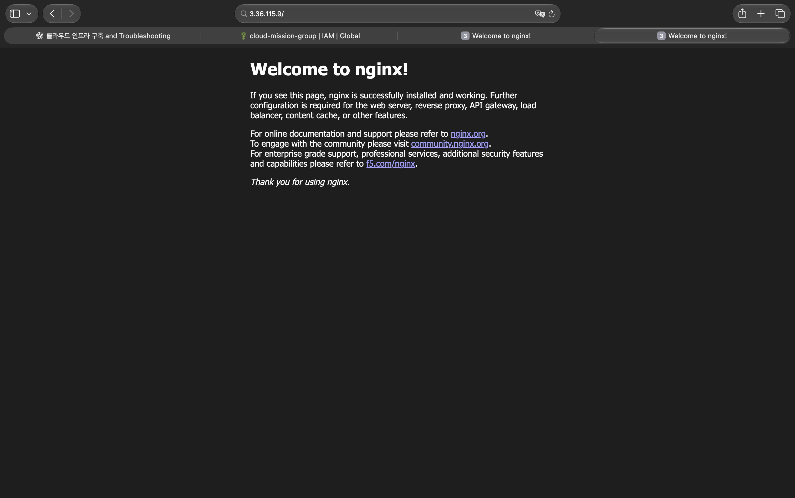

# AWS 클라우드 인프라 구축 및 트러블슈팅 — 미션 3-1

> AWS 서울 리전(ap-northeast-2)에서 VPC, Public Subnet, Internet Gateway, EC2, Security Group 및 IAM 최소권한을 적용하고, Nginx 웹 서비스의 외부 접속을 검증한 실습 기록.

## 실습 개요

| 구성 요소 | 설정 |
|---|---|
| Region | `ap-northeast-2` (서울) |
| VPC | `cloud-mission-vpc` — `10.0.0.0/16` |
| Public Subnet | `cloud-mission-public-subnet` — `10.0.1.0/24` (`ap-northeast-2a`) |
| Internet Gateway | `cloud-mission-igw` |
| Route Table | `cloud-mission-public-rt`; `10.0.0.0/16 → local`, `0.0.0.0/0 → IGW` |
| EC2 | `cloud-mission-ec2`, Amazon Linux 2023, `t3.micro`, EBS 8 GiB gp3 |
| Security Group | `cloud-mission-sg`: TCP 22 = 개인 IP /32, TCP 80 = `0.0.0.0/0` |
| 서버 | Nginx 1.30.7 |
| 인증 | IAM 사용자 `cloud-mission-user`, `CloudMissionLeastPrivilegePolicy` 사용 |
| 실습일 | 2026-11-20 |

## 외부 접속 검증 — 방식 A

- **검증 방식:** (A) 외부 브라우저에서 HTTP 페이지 열기
- **당시 확인 URL:** http://3.36.115.9
- **검증 결과:** 외부 Safari 브라우저에서 **Welcome to nginx!** 페이지 확인

### 외부 접속 증빙 스크린샷



[저장소 내부 증빙 이미지 보기](docs/external-access.png)
- **주의:** 퍼블릭 IPv4는 인스턴스 중지/재시작 시 달라질 수 있으며, 실습 정리 후 URL은 더 이상 유효하지 않음

### HTTP 헬스 체크 (기본 경로 `/`)

이번 실습은 별도 `/health` API를 구현하지 않았으며, Nginx 기본 경로 `/`를 **적절한 웹 서버 생존 확인 엔드포인트**로 사용한다. 이는 Nginx의 응답 가능 여부만 나타내며 애플리케이션 전체의 정상 상태까지 보장하지 않는다.

**실제로 실행해 확인한 내부 HTTP 응답 (2026-11-20):**

```console
[ec2-user@ip-10-0-1-15 ~]$ curl -I http://localhost
HTTP/1.1 200 OK
Server: nginx/1.30.7
Content-Type: text/html
Content-Length: 896
```

`curl -I`는 HTTP **HEAD** 요청이므로 본문을 내려받지 않는다. 아래 명령은 추가 검증 및 재검증에 사용한다. GET 검증은 2026-11-21에 실제 실행했다.

```bash
curl -i http://3.36.115.9/
# 또는 HTTP 상태 코드만 확인
curl -s -o /dev/null -w '%{http_code}\n' http://3.36.115.9/
```

외부 브라우저의 GET 기반 페이지 표시는 [외부 접속 증빙](docs/external-access.png)에서 이미 확인했다.

**추가 수행한 HTTP GET 검증 (2026-11-21):** EC2에 SSH 접속한 터미널에서 `curl -i http://3.36.115.9/`를 실행해 `HTTP/1.1 200 OK`, `Server: nginx/1.30.7` 및 HTML 본문 반환을 확인했다. 이는 **EC2 내부에서 퍼블릭 IP로 요청한 결과**이며, 독립된 외부 클라이언트 검증은 위 브라우저 스크린샷을 참고한다.


[HTTP GET 응답 스크린샷 원본](https://github.com/user-attachments/assets/4f98a56b-d9ac-4f3c-b099-f501b7329de0)

### 추가 확인

```bash
# EC2 SSH 로그인: 성공
ssh -i cloud-mission-key.pem ec2-user@3.36.115.9
# 서버 내부
curl -I http://localhost
# HTTP/1.1 200 OK
curl -I https://example.com
# HTTP/2 200
```

### 추가 실습 증빙

**EC2 아웃바운드 인터넷 통신:** EC2 터미널의 `curl -I https://example.com` 응답 `HTTP/2 200`.


**Nginx 실행 및 내부 HTTP 검증:** `systemctl status nginx`의 `active (running)` 상태와 `curl -I http://localhost` 실행 장면. HTTP 200 응답은 위의 실제 터미널 출력 기록에 별도로 제시했다.


> 위 두 이미지는 GitHub 이슈 첨부 링크로 포함했다. 저장소 내부 PNG 독립 파일로 보관하려면 추후 `docs/`에 별도로 업로드하면 된다.

### 보안 그룹

| 구분 | 프로토콜/포트 | 허용 대상 | 사유 |
|---|---|---|---|
| SSH | TCP/22 | 실습 당시 개인 공인 IP `121.135.181.35/32` | 관리용 SSH 제한 |
| HTTP | TCP/80 | `0.0.0.0/0` | 외부 웹 서비스 접속 |

보안 그룹은 인스턴스 트래픽을 제어하고, IAM 정책은 AWS API/콘솔 작업 권한을 제어한다. `AdministratorAccess` 없이 실습 범위를 한정하는 IAM 정책을 생성했다. 2026-11-21에 확인한 사용자 지정 정책 JSON 기준으로, `ec2:Describe*` 및 실습에 필요한 생성·연결·보안 그룹·인스턴스·태그·정리 작업을 허용하고 `aws:RequestedRegion = ap-northeast-2` 조건을 적용했다. **다른 사용자·그룹 연결 정책까지 포함한 유효 권한 전체 감사 및 리소스별 세분화는 수행하지 않았다.**

## 네트워크 흐름과 퍼블릭 라우트의 필요성

`10.0.0.0/16 → local`은 VPC 내부 통신에 사용한다. 반면 `0.0.0.0/0 → Internet Gateway(IGW)`는 VPC 내부 목적지가 **아닌 IPv4 주소**로 향하는 트래픽의 다음 홉을 IGW로 지정한다. 이 경로가 있어야 퍼블릭 서브넷의 EC2가 인터넷으로 패킷을 내보내고 외부 요청에 응답할 수 있다.

- **외부 접속:** 인터넷 브라우저 → IGW → EC2의 퍼블릭 IPv4와 연결된 사설 IPv4 → 보안 그룹 TCP/80 허용 → Nginx. 응답은 EC2 → 라우팅 테이블 기본 경로 → IGW → 브라우저로 돌아간다.
- **아웃바운드 예시:** EC2에서 `curl -I https://example.com` 요청 → `0.0.0.0/0 → IGW` → 인터넷 → 응답 수신 (`HTTP/2 200` 확인).
- **필요 조건:** EC2 퍼블릭 IPv4, 서브넷의 유효한 IGW 기본 경로, 보안 그룹의 허용 규칙이 함께 필요하다. IGW를 연결하거나 라우트를 추가하는 것만으로 인스턴스가 자동으로 공개되는 것은 아니다.
- 본 실습에서는 별도 NAT Gateway 없이 퍼블릭 서브넷의 EC2가 직접 인터넷 통신했다.

## 태그와 리소스 네이밍 표준 (향후 운영 규칙 제안)

리소스 식별과 삭제 대상을 빠르게 구분하기 위해 **영문 소문자 + 하이픈(kebab-case)** 을 사용한다. `cloud-mission-<resource-type>`을 기본 이름으로 하고 VPC, Subnet, EC2 등에는 동일한 운영 태그를 적용한다.

| 태그 키 | 예시 값 | 목적 |
|---|---|---|
| `Project` | `codyssey-mission3-1` | 같은 과제 리소스 묶음 |
| `Environment` | `lab` | 실습/운영 환경 구분 |
| `Owner` | `student` | 관리 책임자 식별 (개인정보 대신 역할명) |
| `ManagedBy` | `manual` | 콘솔에서 수동 생성 |
| `Cleanup` | `after-evaluation` | 평가 종료 후 삭제 대상 표시 |

| 리소스 | 이름 규칙 | 현재 이름 예시 |
|---|---|---|
| VPC | `cloud-mission-vpc` | `cloud-mission-vpc` |
| Subnet | `cloud-mission-public-subnet` | `cloud-mission-public-subnet` |
| IGW | `cloud-mission-igw` | `cloud-mission-igw` |
| Route Table | `cloud-mission-public-rt` | `cloud-mission-public-rt` |
| Security Group | `cloud-mission-sg` | `cloud-mission-sg` |
| EC2 | `cloud-mission-ec2` | `cloud-mission-ec2` |

**주의:** `Name` 태그는 기존 콘솔에서 확인했으나, 위 `Project`·`Environment` 등 공통 태그가 실제 모든 리소스에 적용됐는지는 아직 검증하지 않았다. 이 표는 **추가 운영 표준 제안**이며 기존 적용 사실을 뜻하지 않는다. IAM 정책의 `ec2:CreateTags`·`ec2:DeleteTags`는 태그 생성·삭제 작업과 연관된다. 비용 배분 태그는 사용 목적에 따라 별도 활성화해야 한다.

## IAM 최소권한 검토

- 정책: `CloudMissionLeastPrivilegePolicy` (그룹 `cloud-mission-group`에 연결)
- EC2 서비스 관련 조회·생성·수정·삭제를 명시적으로 허용하며 서울 리전 조건을 적용함
- S3, RDS, `AdministratorAccess` 허용 문은 **확인한 JSON에 없음**
- `ec2:Describe*` 및 `Resource: "*"`는 일부 조회에 필요할 수 있지만, 자원 단위의 최협의 최소권한은 아님
- 권한 관리 역할과 네트워크 보안 그룹의 역할이 다름: IAM은 AWS API 조작 권한, Security Group은 서버 TCP 트래픽 접근 제어

### 최소권한 부여·점진적 확장 절차

1. **요구 작업 정의:** VPC/Subnet/IGW/Route Table/SG 생성, EC2 시작과 삭제 등 실습 기능의 API 작업 목록만 먼저 작성한다.
2. **최소 정책 부여:** 필요한 `ec2:` 액션만 허용하고, `aws:RequestedRegion=ap-northeast-2`를 적용한다. 리소스별 제한을 지원하는 API는 ARN/태그 조건 적용을 추가 검토한다.
3. **IAM 사용자로 실습 검증:** VPC·EC2 생성, SSH, Nginx HTTP 검증 등 실제 사용 흐름으로 작업 가능 여부를 확인한다.
4. **AccessDenied 발생 시 원인 확인:** 오류에 나타난 작업명, 대상 리소스, 조건을 기록한다. 필요한 기능인지 판단하고 불필요한 권한(예: CloudWatch 지표 조회)은 추가하지 않는다.
5. **필요한 작업만 단계적으로 추가:** 실제 필수 작업이 차단될 때에만 정책 버전을 수정하고 **해당 액션만** 부여한다. 변경 후 동일 기능을 재검증한다.
6. **정기 검토 및 회수:** 평가 종료 후 미사용 권한·키 페어·실습 리소스를 정리하고 정책을 재검토한다.

본 실습에서 확인한 정책은 `ec2:Describe*`와 `Resource: "*"`를 사용하므로 **완전한 최소권한이라고 단정하지 않는다.** 정책 생성 이전부터 단계적으로 확장했다는 수행 로그도 없으므로 위 내용은 앞으로 적용할 **운영 절차**다.

## 제출 자료

- [아키텍처 다이어그램](docs/architecture.pdf) — 인터넷 → IGW → 라우팅 → Public Subnet → SG → EC2/Nginx 트래픽 구조
- [트러블슈팅 보고서](docs/troubleshooting.md) — 실제 CIDR 중복 오류 및 검증 내용
- [리소스 정리 체크리스트](docs/cleanup-checklist.md) — 삭제 후 실제 완료 여부를 체크할 것
- [외부 접속 증빙 독립 PNG](docs/external-access.png) — 외부 브라우저 접속 성공 화면

## 사용 명령

```bash
sudo dnf update -y
sudo dnf install nginx -y
sudo systemctl enable --now nginx
sudo systemctl status nginx --no-pager
curl -I http://localhost
curl -I https://example.com
```

## 운영·확장·비용 관리 계획 (실습에 실제 도입하지 않은 방안)

현재는 `t3.micro` 1대에 Nginx를 배포했으며 로드 밸런서는 사용하지 않았다. 서비스 운영 시에는 다음을 단계적으로 고려한다.

| 관찰 항목 | 병목 신호 | 대응 |
|---|---|---|
| CPUUtilization | CPU 지속 고사용률 | 요청 패턴·프로세스 점검, 인스턴스 스펙/수평 확장 검토 |
| CPUCreditBalance (`t3`) | CPU 크레딧 감소/소진 | 버스트 사용량 확인, 인스턴스 패밀리 검토 |
| 메모리 | 여유 메모리 부족, OOM | OS 지표 수집(필요 시 CloudWatch Agent), 애플리케이션 메모리 분석 |
| EBS | 용량 부족, 대기시간/처리량 상승 | 디스크 사용량·I/O 분석, 필요한 범위만 증설 |
| 응답 지연·오류율 | 5xx 증가, 지연 상승 | Nginx access/error 로그 및 서비스 상태 점검 |

트래픽이 증가해 단일 EC2가 병목 또는 단일 장애점이 된다면 **ALB(Application Load Balancer, 애플리케이션 로드 밸런서)** 와 다수의 EC2, 헬스 체크를 고려한다. ALB는 HTTP/HTTPS 요청을 정상 대상에 분산하고, 고가용성을 위해 서로 다른 가용 영역의 서브넷 구성이 필요하다. 단, **이번 단일 EC2·단일 서브넷 미션에는 ALB를 생성하지 않는다.**

비용 추적: Billing & Cost Management의 Cost Explorer(서비스/리전/사용량 분류), Budgets 예산 알림, EC2 실행시간, EBS 용량, 퍼블릭 IPv4 사용시간, ALB·NAT Gateway 추가 과금 여부 등을 주기적으로 확인한다. IAM 사용자에게 결제 정보 권한이 없는 경우 적절한 권한의 계정 관리자가 확인한다. 무료 플랜 크레딧이나 프리 티어에 해당하더라도 실제 조건 및 잔액을 확인해야 한다.

## 운영 및 비용

**2026-11-21 현재 평가 대기 중으로 인스턴스를 유지하기로 결정했다.** EC2, EBS, 퍼블릭 IPv4 등은 사용량에 따라 요금이나 무료 크레딧 차감이 발생할 수 있다. **문서 작성만으로 리소스가 삭제되는 것은 아니다.** 반드시 [정리 체크리스트](docs/cleanup-checklist.md)에 따라 서울 리전의 실제 AWS 리소스를 삭제·검증해야 한다.

## 비밀 정보 관리

`.pem` 개인키, 비밀번호, 액세스 키, 세션 토큰은 레포에 올리지 않는다.
